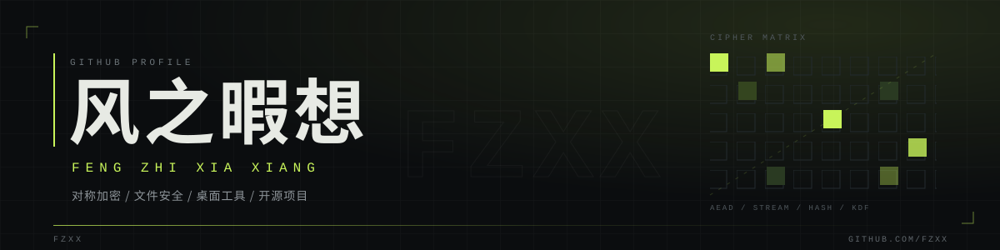



  

<h3 align="center">写加密算法，也写能把它们用起来的工具。</h3>

  独立开发者，作品集中在自研密码库与文件安全。

  
  
  
  
  

---

### 数据概览

<table>
  <tr>
    <td width="50%" valign="top">
      
    </td>
    <td width="50%" valign="top">
      
    </td>
  </tr>
</table>

### 代表项目

<table>
  <tr>
    <td width="50%" valign="top">
      
    </td>
    <td width="50%" valign="top">
      
    </td>
  </tr>
  <tr>
    <td width="50%" valign="top">
      
    </td>
    <td width="50%" valign="top">
      
    </td>
  </tr>
  <tr>
    <td width="50%" valign="top">
      
    </td>
    <td width="50%" valign="top">
      
    </td>
  </tr>
  <tr>
    <td width="50%" valign="top">
      
    </td>
    <td width="50%" valign="top">
      
    </td>
  </tr>
  <tr>
    <td width="50%" valign="top">
      
    </td>
    <td width="50%" valign="top">
      
    </td>
  </tr>
</table>

### 技术方向

  
  
  
  
  
   
  
  
  
  

### 博客

[风之暇想博客](https://www.fzxx.xyz) — 软件综合分享站，收集实用软件、折腾教程、资讯与图床。

---

  更多内容见项目详情

